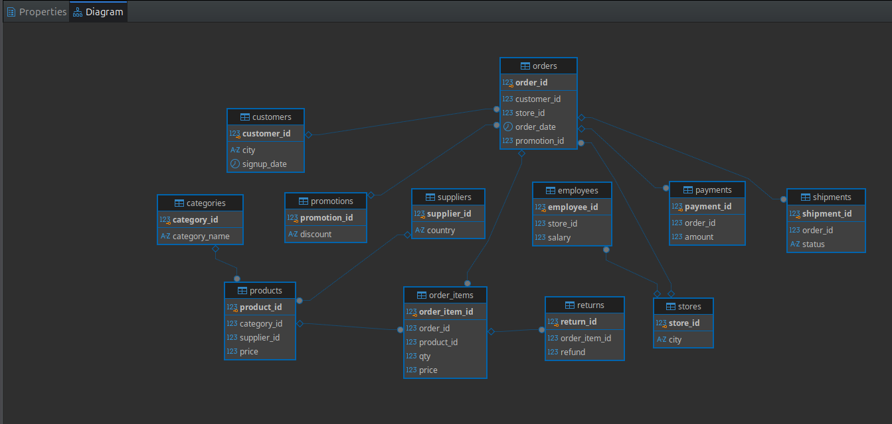

# Data Analysis with SQL
# Retail Data Warehouse Analysis
- The retail data warehouse is an SQL practical project that contains 12 interconnected tables. It explores the different aspect of retail business performance and demostratses how SQL can be used to answer real world business questions.

## SQL
- Data quality
 - Checking data intergrity, missing records and table relationships.
- Sales Analysis
 - Revenue trends, monthly sales performance, order volumes and average order value.
- Customer Analysis
 - Customer purchasing behaviour and engagement.
- Product & Category Analysis
 - Best-selling products and top revenue-generating categories.
- Store Performance
 - Comparing sales across stores and cities.
- Supplier Analysis
 - Supplier product distribution and revenue contribution.
- Promotions & Discounts
 - Exploring promotional performance and effect of discounts on total revenue.
- Returns Analysis
 - Investigating product returns and their impact on revenue.
## Tools and technologies
- Query language - SQL
- Database - PostegreSQL
- Data visualization - Metabase
- Version control - Git&Github
- Metabase Dashboards screenshorts
## SQL concepts applied
- SELECT, WHERE and ORDER BY
- JOINs and aggregations
- GROUP BY and HAVING
- Common Table Expressions (CTEs)
- Subqueries
- Window Functions
- CASE statements
- Date and time functions
- Data validation and quality checks
## Insights
- Business recommendations
## Currentlt learning
- Advanced SQL and PostgreSQL.
- Exploratory Data Analysis (EDA).
- Business Intelligence and dashboard development.
- Data storytelling and communicating business insights.
- Building end-to-end data analytics projects.